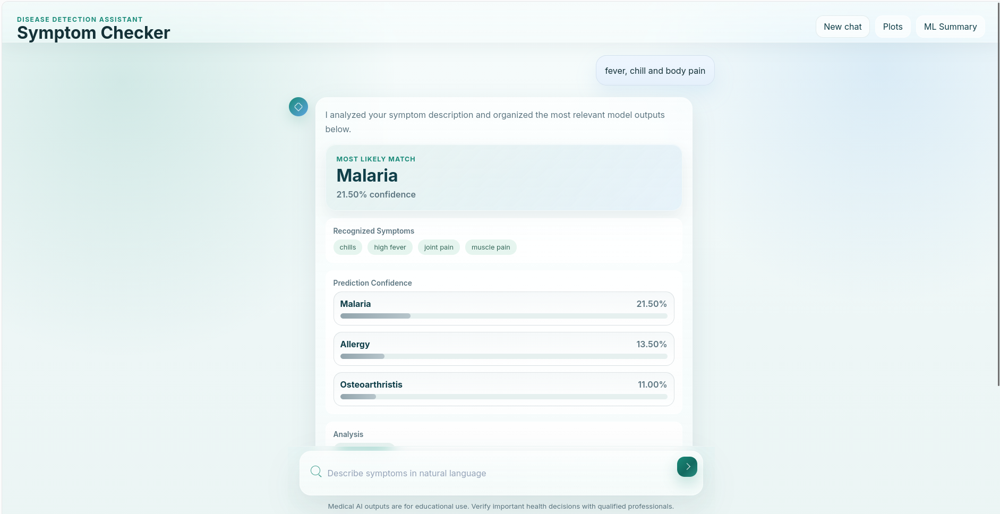
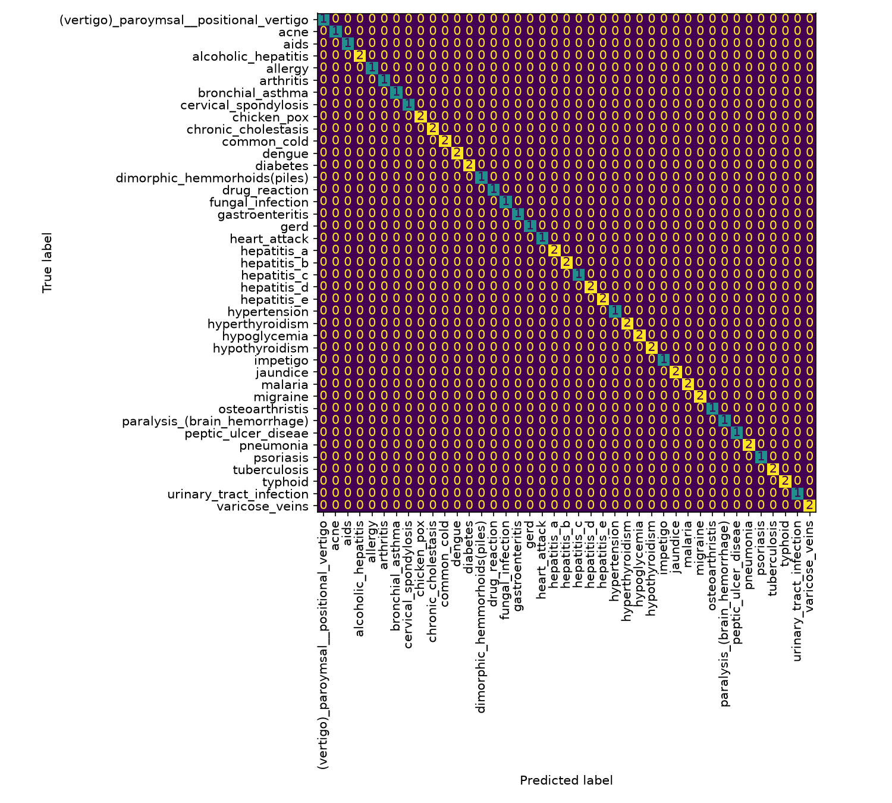
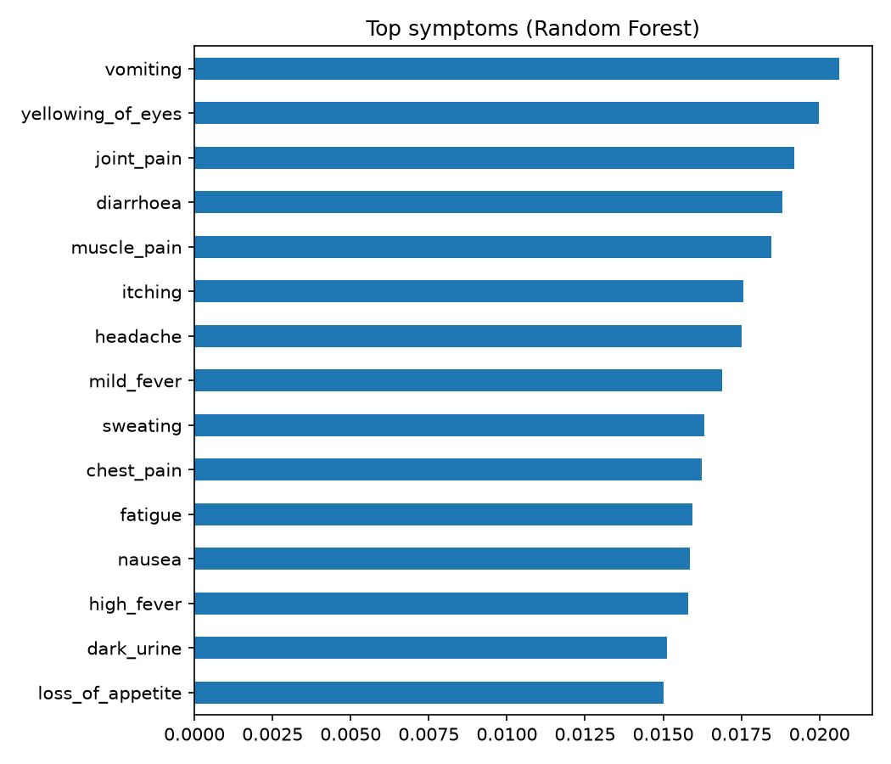

# Disease Detection System using Machine Learning

A symptom-based disease prediction assistant with a web chat interface. Users type symptoms in plain English
(e.g. _"fever, chills, body pain"_) and the system returns the most likely conditions with
probabilities, general advice, and a symptom-pattern cluster.

> ⚠️ **Educational project only. Not a medical device and not a substitute for a doctor.**




## Features

- Supervised learning: Random Forest on the real dataset (Decision Tree on the built-in demo data if the real file is absent)
- Unsupervised learning: KMeans clustering + PCA visualisation of symptom patterns
- Natural-language symptom parsing (keyword/synonym matching)
- Web chat interface (HTML/CSS/JS) served by a lightweight Python backend, plus a CLI mode
- Model comparison on a real dataset with cross-validation (`src/train_real_dataset.py`)

## Project structure

```
src/app.py                    # model, API server, CLI
src/prepare_dataset.py        # converts text-symptom CSVs to a 0/1 matrix
src/train_real_dataset.py     # model comparison on a real dataset
webapp/                       # frontend (HTML/CSS/JS)
data/real/                    # real dataset used by the web app + descriptions and precautions
data/synthetic/               # generated demo dataset (fallback)
data/raw/                     # put the real dataset here (not committed)
reports/                      # generated metrics and plots
docs/                         # project report and images
```

## Setup

```bash
git clone https://github.com/Amir-Khan11/disease-detection-ml.git
cd disease-detection-ml
python -m venv .venv && source .venv/bin/activate   # Windows: .venv\Scripts\activate
pip install -r requirements.txt
```

## Real dataset in the web app

1. Download `dataset.csv` from the Kaggle "Disease Symptom Prediction" dataset into `data/raw/`.
2. Build the cleaned 0/1 file (duplicates removed) directly into `data/real/`:
   ```bash
   python src/prepare_dataset.py --input data/raw/dataset.csv --output data/real/symptoms_binary.csv --dedupe
   ```
   `data/real/` already contains `symptom_Description.csv` and `symptom_precaution.csv`.
3. Start the app. If `data/real/symptoms_binary.csv` exists the app trains a Random Forest on it
   (41 diseases, 131 symptoms) and shows each disease's description and precautions; otherwise it
   falls back to the small synthetic demo data.

## Run the web app

```bash
python src/app.py --open-browser                     # opens http://127.0.0.1:8000
python src/app.py --cli "fever, chills, body pain"   # command-line mode
```

## Evaluation on a real dataset
The cleaned dataset is included in `data/real/symptoms_binary.csv`, so you can run the comparison directly:
```bash
python src/train_real_dataset.py --data data/real/symptoms_binary.csv --target disease
```

## Results

Dataset: 4,920 rows in the raw file, **304 unique rows** after removing 4,616 duplicates; 131 symptoms; 41 diseases.

| Model               | Accuracy (5-fold CV) | Macro-F1 |
| ------------------- | -------------------- | -------- |
| Random Forest       | 100.0%               | 1.000    |
| Logistic Regression | 100.0%               | 1.000    |
| Naive Bayes         | 97.7%                | 0.966    |
| Decision Tree       | 36.9%                | 0.282    |




### Findings

- The raw dataset is about 94% duplicate rows. Evaluating on it without deduplication leaks identical rows into
  the test set and inflates accuracy, so duplicates are removed first.
- The dataset is clean and artificially generated (each disease has its own symptom pattern), so near-perfect
  scores do **not** mean the system would work on real patients.
- The single Decision Tree scores far lower than the other models. With only about 7 unique examples per
  disease, a single tree is likely unstable; ensembles and linear models cope better.

## Limitations

- The fallback demo dataset is **synthetic** (390 rows, only 51 unique), so its ~94% accuracy is inflated by duplicates.
- The real dataset is clean and artificially generated, so the web app's accuracy figure (near 100%) is not a
  real-world estimate. With only a few typed symptoms, probabilities are spread across several diseases.
- Binary symptoms only: no severity, duration, age or lab values.
- Keyword-based parsing misses misspellings and complex sentences.

## Future work

Use the dataset's severity scores, NLP-based symptom extraction, probability calibration, SHAP explanations, Docker and deployment.

## License

MIT
