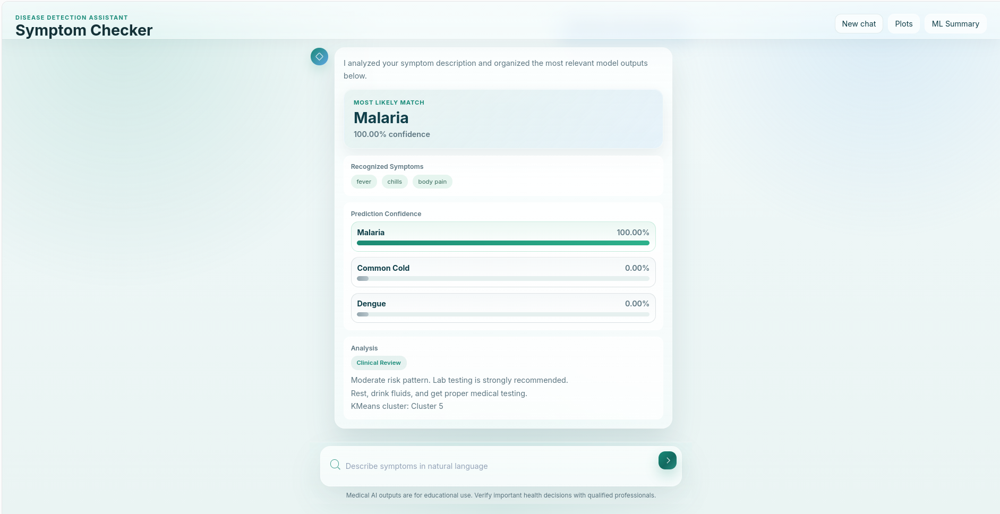

# Disease Detection System using Machine Learning

A symptom-based disease prediction assistant with a web chat interface. Users type symptoms in plain English
(e.g. _"fever, chills, body pain"_) and the system returns the most likely conditions with
probabilities, general advice, and a symptom-pattern cluster.

> ⚠️ **Educational project only. Not a medical device and not a substitute for a doctor.**



## Features

- Supervised learning: Decision Tree classifier (scikit-learn)
- Unsupervised learning: KMeans clustering + PCA visualisation of symptom patterns
- Natural-language symptom parsing (keyword/synonym matching)
- Web chat interface (HTML/CSS/JS) served by a lightweight Python backend, plus a CLI mode
- Model comparison on a real dataset with cross-validation (`src/train_real_dataset.py`)

## Project structure

```
src/app.py                    # model, API server, CLI
src/prepare_dataset.py        # converts text-symptom CSVs to a 0/1 matrix
src/train_real_dataset.py     # model comparison on a real dataset
webapp/                       # frontend (HTML/CSS/JS)
data/synthetic/               # generated demo dataset used by the web app
data/raw/                     # put the real dataset here (not committed)
reports/                      # generated metrics and plots
docs/                         # project report and images
```

## Setup

```bash
git clone https://github.com/Amir-Khan11/disease-detection-ml.git
cd disease-detection-ml
python -m venv .venv && source .venv/bin/activate   # Windows: .venv\Scripts\activate
pip install -r requirements.txt
```

## Run the web app

```bash
python src/app.py --open-browser                     # opens http://127.0.0.1:8000
python src/app.py --cli "fever, chills, body pain"   # command-line mode
```

## Evaluation on a real dataset

1. Download the Kaggle **"Disease Symptom Prediction"** dataset and put `dataset.csv` in `data/raw/`.
2. Convert the text symptoms into a 0/1 matrix:
   ```bash
   python src/prepare_dataset.py --input data/raw/dataset.csv --output data/processed/symptoms_binary.csv
   ```
3. Compare models:
   ```bash
   python src/train_real_dataset.py --data data/processed/symptoms_binary.csv --target disease
   ```
   This runs stratified 5-fold cross-validation on Decision Tree, Naive Bayes, Logistic Regression and
   Random Forest, removes duplicate rows to avoid train/test leakage, and writes `model_comparison.csv`,
   a classification report, a confusion matrix and top-symptom importances to `reports/`.

(The Kaggle "Disease Prediction Using Machine Learning" `Training.csv` also works directly with `--target prognosis`.)

## Results

Dataset: 4,920 rows in the raw file, **304 unique rows** after removing 4,616 duplicates; 131 symptoms; 41 diseases.

| Model               | Accuracy (5-fold CV) | Macro-F1 |
| ------------------- | -------------------- | -------- |
| Random Forest       | 100.0%               | 1.000    |
| Logistic Regression | 100.0%               | 1.000    |
| Naive Bayes         | 97.7%                | 0.966    |
| Decision Tree       | 36.9%                | 0.282    |

### Findings

- The raw dataset is about 94% duplicate rows. Evaluating on it without deduplication leaks identical rows into
  the test set and inflates accuracy, so duplicates are removed first.
- The dataset is clean and artificially generated (each disease has its own symptom pattern), so near-perfect
  scores do **not** mean the system would work on real patients.
- The single Decision Tree scores far lower than the other models. With only about 7 unique examples per
  disease, a single tree is likely unstable; ensembles and linear models cope better.

## Limitations

- The web app currently uses a Decision Tree trained on the small **synthetic** demo dataset (390 rows, only 51
  unique), so its own ~94% accuracy figure is inflated by duplicates.
- Binary symptoms only: no severity, duration, age or lab values.
- Keyword-based parsing misses misspellings and complex sentences.

## Future work

Use the Random Forest and the real dataset in the web app, add disease descriptions and precautions from the
dataset's extra CSVs, NLP-based symptom extraction, probability calibration, SHAP explanations, Docker and deployment.

## License

MIT
